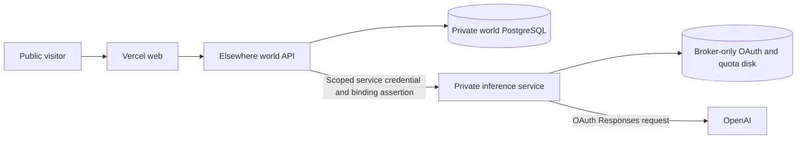

# Ownership and hosted Hubert

Elsewhere is the platform. A character is an independently owned identity with private state and explicitly granted resources. The current admission policy enables **Hubert only**. Visitor accounts do not create residents, and no public character creation, connection linking or ChatGPT enrollment endpoint is enabled.

## Authority and records

| Record or role         | Meaning                                                                 | Current implementation                                                |
| ---------------------- | ----------------------------------------------------------------------- | --------------------------------------------------------------------- |
| User/platform role     | A human account and permission to moderate the world                    | Better Auth; admin role permits pause/resume                          |
| Character registration | Stable character ID and exact private owner user ID                     | `packages/identity`; sole Hubert registry                             |
| Residency              | Permission for a character to live in a world                           | Explicit admission; only Hubert enabled                               |
| Provider connection    | A human-owned authorization to a service                                | Metadata in policy; OAuth secrets only in protected inference storage |
| Character grant        | Which world/character/owner may use a connection for which capabilities | Strict resolution, revisions, expiry and revocation                   |

Platform administration does not establish character ownership. Advancing/resetting Hubert or deciding his wishes through a signed-in session requires exact ownership. `HUBERT_OWNER_USER_ID` is the **hosted Elsewhere account's User ID**, not an email address, display name, ChatGPT subject or `AUTH_ADMIN_USER_IDS`. Accounts can hold both roles independently. The private session response reports `managedCharacterIds`; public snapshots do not publish that mapping or the authentication owner ID. Existing public `resident.ownerId` remains an opaque legacy alias; saved life data is not silently reassigned.

The existing bootstrap `ADMIN_TOKEN` is an explicit sole-resident operator capability retained for setup/recovery. It is distinct from a signed-in account's admin role and must never be distributed to ordinary moderators or reused as an inference credential. Future residency cannot reuse that blanket capability without an explicit policy/API change.

Connector proposals contain opaque binding/capability/resource IDs. The host supplies the authenticated owner/world/character principal and validates grants. Characters, visitor notes and request bodies cannot provide authority or see tokens. External connector execution remains staged; the implemented execution service here supports model decisions and dreams only.

## Hosted process boundary

The service can also run on an existing personal VPS; see [VPS setup and SSH/Docker handoff](vps-inference.md). Render is an optional deployment profile rather than a runtime dependency.



The world receives only the broker's address and a dedicated service credential. The private broker fixes the owner, world, character, connection, trusted persona, model and allowed workloads. Each request asserts the expected binding; the broker compares it to its own configuration rather than accepting a caller-selected identity. This prevents accidental connections to a different owner's service. Vercel receives neither this credential nor OAuth tokens.

The broker independently reserves its durable daily allowance before dispatch. Decision and reflection share that limit; world runtime reservations remain a second boundary. Only one request executes at a time; oversized/deep inputs, browser-origin requests, wrong bindings, revoked grants and unavailable sessions are refused. Model results pass the existing command/dream validators and then the world's policy/feasibility checks. There are no arbitrary provider URLs, tool executors, paid fallbacks or automatic inference retries.

A missing OAuth session is an ordinary unprovisioned state: the broker keeps listening, reports unavailable on protected readiness, and performs no inference. The world continues with its local planner. This allows secure initial import into the live service. No personal laptop connection or tunnel is needed after successful handoff; the hosted service owns refreshes.

## Render setup prepared in source

The optional replacement Blueprint is `infra/production/render-hosted.yaml`. The existing root `render.yaml` remains the deterministic deployment and is not modified to silently add a paid service.

The hosted Blueprint uses the existing world service/database and adds a private `pserv` in the same region with one persistent 1 GB disk. The disk belongs exclusively to inference and is never mounted by the public world, frontend or workers. Disk-backed redeploys stop the old instance before starting the replacement; a brief inference outage is expected. Private network access still requires the service credential.

1. Choose/migrate the hosted Better Auth account and obtain its exact User ID. World snapshot transfer does not migrate local auth accounts. Set that ID as `HUBERT_OWNER_USER_ID` on inference; the world references the same value.
2. Review the additional paid private service/disk and current credit balance. Change the existing Blueprint's file path instead of creating duplicate world/database resources. Automatic deploy remains off. On an existing Blueprint, newly added `sync:false` values must be installed manually in the service settings.
3. Import the existing world using the world snapshot workflow. Leave `ALLOW_NEW_LIFE=false`; do not erase memories to get a deployment running. Vercel keeps only its backend address and existing ingress secret. Use the actual public origin, currently chosen by the operator, for `WEB_ORIGIN`.
4. Confirm the broker's disk is mounted at `/var/lib/elsewhere-inference` and writable by its `node` user. The image creates the expected directory with private permissions. `INFERENCE_DATA_ROOT` must be persistent, absolute storage; `/tmp` and equivalent temporary roots are rejected in production. The broker must be running before SSH import; one-off/pre-deploy/ephemeral instances cannot access this disk.
5. Configure your own SSH public key in Render and verify/pin Render's SSH host key using a trusted source or the dashboard instructions. The transfer command requires an existing trusted host key and noninteractive key authentication; it never disables host verification.
6. Stop local Elsewhere processes using the selected ChatGPT profile, then hand the session to the specific private service:

```sh
pnpm chatgpt transfer --profile default \
  --destination YOUR_SERVICE@ssh.frankfurt.render.com \
  --owner-user-id YOUR_HOSTED_ELSEWHERE_USER_ID
```

Use the SSH address shown for the **inference** service. This command is not run automatically. It sends the selected session only over encrypted stdin to a fixed operator command. It never prints tokens or copies the laptop's host ID. The destination creates/preserves its own host identity and validates the owner/profile before import. Existing world or quota state is not replaced.

Local use is quarantined **before** transmitting. A confirmed handoff clears local tokens without revoking the remote session. If the connection fails after import, local requests remain disabled. Retrying the exact transfer safely acknowledges the same transfer ID without replacing already-rotated remote credentials. A different destination/owner/profile cannot reuse that pending transfer. Do not manually clear the quarantine or copy old token backups back into use.

Inspect local handoff state with `pnpm chatgpt status`. For private remote status, use Render SSH to run `node /app/dist/inference-operator.mjs status` on the live service; it reports safe status without credentials. A stale lock after a crash requires stopping processes and verified offline recovery, never automatic lock theft. Restoring old disk snapshots may restore obsolete refresh tokens; reauthorization can be necessary.

## Extension points and limits

Future onboarding can create a user-owned character registration, connection and explicit grant, then admit that residency. Generic ownership and inference transport contracts already carry those scopes. Enabling another resident still requires a deliberate host admission and runtime composition change; it cannot happen through signup or a model request. A character's identity/state remains independent of its current model provider.

Public BYO-ChatGPT onboarding remains disabled until OpenAI permits the actual hosted offering and separate account onboarding/vault isolation are implemented. The [self-hosted VM flow](https://developers.openai.com/siwc/token-sharing-open-source/self-hosted-vms) describes personal hosted session transfer; it does not establish approval to offer hosted ChatGPT linking to everyone. See the [OpenAI overview](https://developers.openai.com/siwc/token-sharing-open-source).

Normal application roles cannot spend another owner's resources. The infrastructure operator still controls the machines and is a trusted party; these controls are not cryptographic protection against a malicious host operator. Future owner-operated inference workers can use the same narrow transport boundary if stronger hosting independence is needed.

Relevant Render references: [private services](https://render.com/docs/private-services), [persistent disks](https://render.com/docs/disks), [SSH](https://render.com/docs/ssh), [Blueprints](https://render.com/docs/blueprint-spec).
